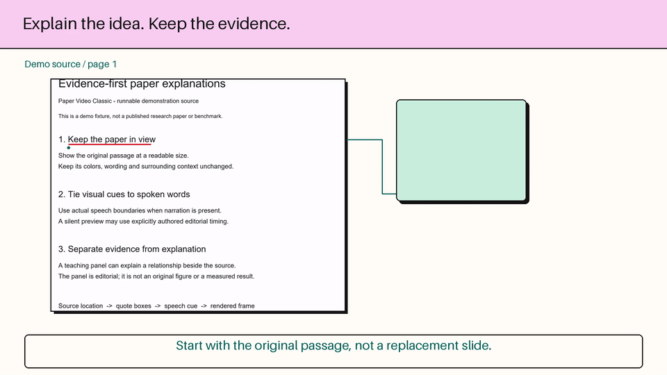

# Paper Video Classic：原文为主场的论文讲解视频

[**Thomas Li**](https://github.com/litaohz) 的旧版论文视频方法，整理成可运行的开源适配版。

> 不把论文改成一叠摘要幻灯片，而是在真实原文上定位、画线，在旁边把机制讲清楚。



[完整静音示例](docs/demo.mp4)

这是第一代 Classic 流程：原文定位、渐进标注、来源连接的教学卡片、确定性出片。**不包含新版笔触制作系统，也不是私人工作目录的整包备份。**

## 先跑起来

需要 Python 3.10+，以及在 PATH 中的 FFmpeg 和 FFprobe。默认示例不需要 GPU、API key、浏览器或 Agent。

```bash
git clone https://github.com/litaohz/paper-video-classic.git
cd paper-video-classic
python -m pip install -e .
python -m paper_video.cli demo --out out/demo
```

打开 `out/demo/render/video.mp4`。程序会生成一份明确标注的演示 PDF，在真实文本层中寻找句子和坐标，生成1080p/24fps视频，完成整片解码，并保存验证报告与成片标注帧。已有输出不会覆盖。

**默认示例是静音的**，时间轴明确标为编辑设定，不冒充语音原生时间戳。演示 PDF 讲解这个工具本身，不是虚构的研究论文或实验成绩。仓库不附带第三方论文全文。

## 这套方法的重点

- 原文是证据主场，保持原色、比例和上下文。
- 画线来自实际文本坐标，找不到或命中不唯一就报错，不猜位置。
- 教学图与作者原图分开，解释层从正在讲的来源位置展开。
- 有配音时，用真实音频和原生词级边界对齐字幕与画线，不按字数估时间。
- `frame(t)` 确定性渲染，技术检查与审美、科学内容审阅分开。

## 换成自己的论文

复制示例生成的 `config.json`，替换 PDF 相对路径、页码、裁切区域、唯一原句和教学内容。坐标是左上原点的PDF点。目前附带的参考合成器每次渲染一个页面区域；多章节可分别创作片段再拼接，不是“一键自动读懂整篇论文”。

```bash
python -m paper_video.cli quote --pdf paper.pdf --page 3 --text "a unique exact phrase"
python -m paper_video.cli render --config project/config.json --out out/section --font /path/to/licensed-font.ttf
```

中文请提供自己获准使用的字体；不打包微软雅黑或系统光标。扫描论文需要先做真实OCR，这一版不会伪造文字坐标。

## Agent 与配音

- [Classic Skill](skills/paper-video-classic/SKILL.md)：研究问题、证据链、讲稿、分镜、对时与验收方法，可放入支持Agent Skills的工具中。
- [制作说明](docs/pipeline.md)：目录、输入契约及可选Azure配音。默认示例不调用付费服务；运行Azure适配器才会使用自己的订阅。
- [依赖与许可](THIRD_PARTY_NOTICES.md)：本仓库原创代码采用MIT，第三方依赖/论文/字体/声音适用其各自条款。

保留了Classic的教学方法，但去除了个人路径、私人收件人、自动日程、凭据读取约定、试听队列和私信发布流程。PDF底层用PDFium替代私人旧工程中的PyMuPDF，不把这称为原工程字节级复刻。

## 为什么开源

希望让更多人尝试“证据就在眼前”的论文讲解，也欢迎带着具体论文和可复现问题一起改进。

由 **Thomas Li** 创作与维护。关注重点是原文、讲法和可复现性，而不是用更多动画盖住论文。
